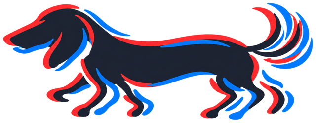
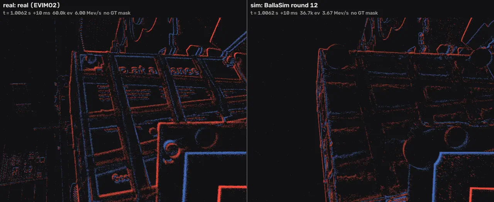
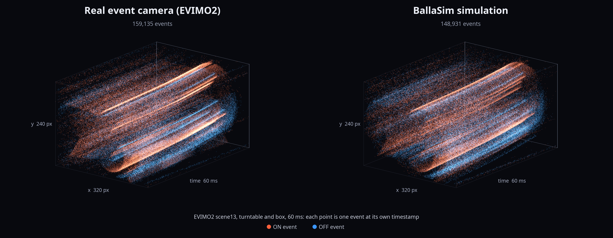
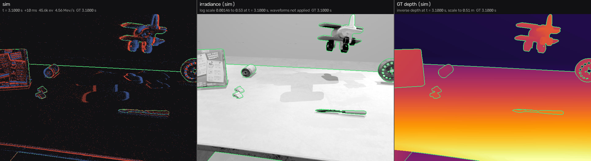

<h1 align="center">
  <picture>
    <source media="(prefers-color-scheme: dark)" srcset="docs/site/source/_static/images/dog-dark.png">
    
  </picture>
  BallaSim <sup>Work in Progress</sup>
</h1>

<p align="center"><b>Event cameras, simulated without frames: every pixel on its own clock, every event with its own timestamp.</b></p>

<p align="center">
  
  <a href="LICENSE"></a>
  <a href="https://howardhuazy.github.io/BallaSim/"></a>
</p>



*Real events (left) and BallaSim's simulation of the same 2 s (right): [EVIMO2](https://better-flow.github.io/evimo/download_evimo_2.html) sfm/eval scene_03_00, a hand-held Prophesee Gen3 camera, 10 ms windows (ON red, OFF blue) at ¼ speed. The simulation is rendered from the scene's 3D scans and motion-capture trajectories.*

BallaSim is an asynchronous, physically grounded event-camera simulator. It is named after Giacomo Balla, whose *Dynamism of a Dog on a Leash* painted motion as a stream of discrete traces.

## Why no frames?

Frame-based pipelines render images and then convert them into events, so event timing is tied to the rendered frames and much of the rendering goes to pixels that did not change. BallaSim drops the frame: each pixel is sampled at its own times, where its signal changes, so every event keeps its own timestamp and the work follows the motion.



*60 ms of EVIMO2 scene13 (turntable and box, table only), real and simulated, every event drawn at its own (x, y, t) with no binning. As on the real sensor, moving edges trace continuous surfaces through time.*

## What you get

- **Events** `(x, y, t, p)` with integer-nanosecond timestamps, from one camera or a multi-camera rig.
- **Per-event ground truth**: instance and semantic id, depth, optical flow, a noise label and a moving flag.
- **Dense ground truth** queried at any timestamp.
- **A physical pixel model**: events are threshold crossings of a sensor model solved in continuous time, noise included.
- **Real and synthetic scenes**: scanned objects and rooms, motion-capture or keyframed trajectories.
- **GPU or CPU**: a C++20/CUDA engine on NVIDIA OptiX or Intel Embree, driven from Python.



*A synthetic tabletop (CC0 and CC BY 4.0 assets) at one instant: the simulated events, the irradiance behind them, and ground-truth depth with instance outlines.*

## How it works

1. **Adaptive per-pixel sampling.** Each pixel chooses its own sample times from an error tolerance: dense where the signal changes, sparse where it does not.
2. **Exact-time ray tracing.** Each sample is ray-traced against the geometry posed exactly at that instant, from continuous trajectories.
3. **A continuous-time pixel model.** Threshold crossings are solved between samples; timestamp quantization is applied only when configured by the readout model.

## Status

BallaSim is under active development, and this repository receives periodic snapshots of it. Interfaces, file formats and parameters may change between snapshots. The [simulation manual](https://howardhuazy.github.io/BallaSim/) covers scene preparation, sensor models, configuration, Python methods, and outputs.

Linux x86-64 with the conda environment in `tools/env/`; an NVIDIA GPU is optional:

```bash
conda create -n ballasim --file tools/env/linux-64.lock
conda activate ballasim
BALLASIM_CUDA=OFF BALLASIM_OPTIX=OFF pip install --no-build-isolation --no-deps -e .   # CPU only
python -m ballasim --help
```

For the GPU path, point `OPTIX_ROOT` at an OptiX SDK and install with `BALLASIM_CUDA=ON BALLASIM_OPTIX=ON`.

## License

[CC BY-NC 4.0](LICENSE): free for non-commercial use with attribution; commercial use needs a separate license from the authors. Copyright, the patent reservation and how to credit BallaSim are in [NOTICE](NOTICE); third-party components keep their own licenses ([THIRD_PARTY_NOTICES.md](THIRD_PARTY_NOTICES.md)). The EVIMO2 recordings in the figures appear with the permission of the EVIMO2 authors.
